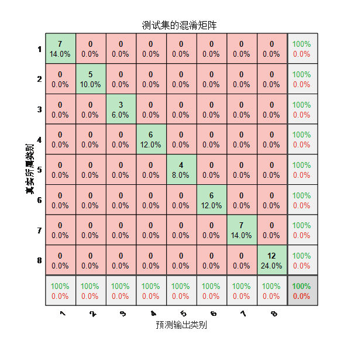
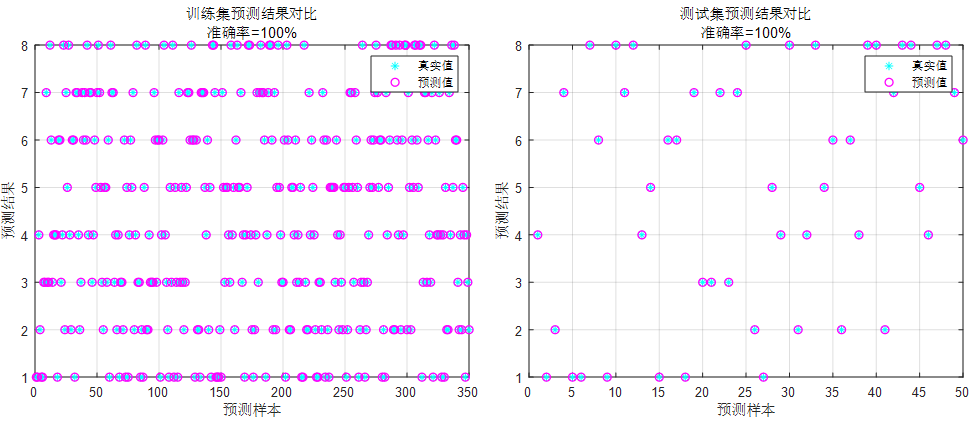
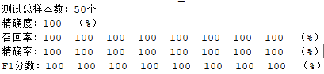
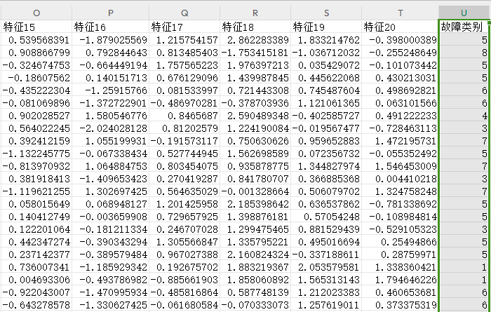

# Fault Identification Program for CNN-BiLSTM-Attention Spatio-Temporal Features - Multi-Head Self-Attention Mechanism, data imported from Excel, run directly.

Applicable Platform: MATLAB 2023 version
A fault recognition program based on CNN-BiLSTM-Attention Convolutional Neural Network with Bidirectional Long Short-Term Memory Network and Attention Mechanism, requiring versions above 2023a.
Single variable feature input, suitable for bearing fault identification/diagnosis/classification, transformer oil gas fault identification/diagnosis/classification, power system transmission line fault area identification/diagnosis/classification, insulator, distribution network fault identification/diagnosis/classification, etc.
Read from an Excel table, directly replace the data to use, without needing to make significant changes to the program. The program contains detailed comments for easy understanding of the program's operation.
Data format:

## Images

<!-- PAYMENT_BLOCK -->

## Get this dataset

- Payment link (Stripe): [Buy now](https://buy.stripe.com/3cs8yP7sY87d0vu9AB)
- Payment QR code: 

<!-- /PAYMENT_BLOCK -->
